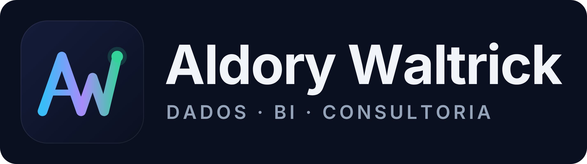

# Marca · Aldory Waltrick

O símbolo é o monograma **AW** desenhado como uma linha de gráfico: o **A** é o primeiro pico, a perna direita do A já começa o **W**, e o traço termina num ponto de dado, como o último valor de uma série que está subindo. Dados, BI e crescimento numa forma só.

## Arquivos

Os SVGs são vetoriais (o texto já está em curvas, não depende de fonte instalada). Use SVG sempre que puder; PNG quando a ferramenta não aceitar SVG.

| Uso | Arquivo |
|---|---|
| Ícone principal (fundo escuro, cantos arredondados) | `svg/aw-icon.svg` · `png/aw-icon-1024.png` · `png/aw-icon-512.png` · `png/aw-icon-256.png` |
| Ícone para fundo claro | `svg/aw-icon-light.svg` · `png/aw-icon-light-1024.png` |
| Foto de perfil (LinkedIn, WhatsApp, GitHub) | `png/aw-avatar-800.png` · `svg/aw-avatar.svg` |
| Capa do LinkedIn (1584 × 396) | `png/linkedin-banner.png` · `svg/linkedin-banner.svg` |
| Logo horizontal, fundo escuro | `svg/aw-logo-dark.svg` · `png/aw-logo-dark.png` |
| Logo horizontal, fundo claro | `svg/aw-logo-light.svg` · `png/aw-logo-light.png` |
| Logo horizontal sem fundo, para fundos escuros | `svg/aw-logo-transparent-dark-bg.svg` · `png/aw-logo-transparent-dark-bg.png` |
| Logo horizontal sem fundo, para fundos claros | `svg/aw-logo-transparent-light-bg.svg` · `png/aw-logo-transparent-light-bg.png` |
| Só o símbolo, sem fundo (fundo escuro / claro) | `svg/aw-mark.svg` · `svg/aw-mark-deep.svg` (+ PNGs 1024) |
| Símbolo monocromático (branco / preto) | `svg/aw-mark-white.svg` · `svg/aw-mark-black.svg` (+ PNGs 1024) |
| Favicon e ícones de app | `svg/favicon.svg` · `png/favicon-16/32/48.png` · `png/apple-touch-icon.png` · `png/icon-192.png` |

Para baixar um arquivo: abra o arquivo no GitHub e clique em **Download raw file** (ícone de download, no canto direito).

## Cores

| Cor | Hex | Uso |
|---|---|---|
| Azul | `#38BDF8` | início do degradê |
| Violeta | `#A78BFA` | meio do degradê |
| Verde | `#34D399` | fim do degradê e ponto de dado |
| Azul-marinho | `#0B1020` | fundo escuro e texto em fundo claro |
| Versão para fundo claro | `#0B72D7` → `#7C3AED` → `#059669` | degradê mais escuro, com contraste no branco |

Tipografia: **Inter** (Bold no nome, SemiBold com espaçamento largo na linha de apoio).

## Boas práticas

- Deixe em volta do símbolo um respiro de pelo menos o tamanho do ponto verde.
- Em fundo claro, use as versões `light` ou `deep`; em fundo escuro, as versões padrão.
- Não distorça, não gire e não troque as cores do degradê.
- Abaixo de 32 px, prefira o `favicon.svg`, que tem traço mais grosso.
